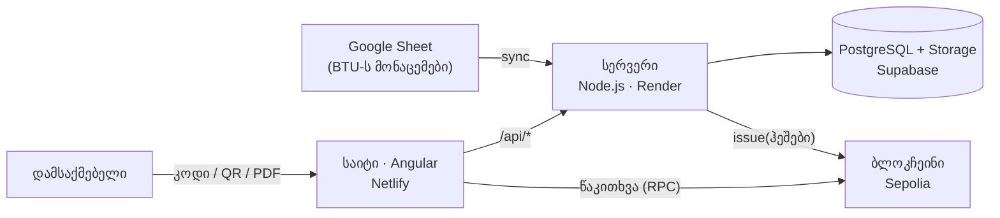

# ტექნიკური მიმოხილვა

BTU AI Skills Digital Passport: BTU ამატებს დადასტურებულ უნარებს Google Sheet-ში, სისტემა გასცემს PDF პასპორტს, ჰეშს ინახავს ბლოკჩეინზე, ხოლო დამსაქმებელს შეუძლია პასპორტის გადამოწმება შესვლის გარეშე.

## 1. არქიტექტურა

- **Sheet** არის მხოლოდ შესატანი ადგილი. ჭეშმარიტების წყარო არის ბაზა და ბლოკჩეინი.
- **სერვერი** ამუშავებს sync-ს, ქმნის PDF-ს და წერს ჯაჭვზე.
- **ბრაუზერი** ჯაჭვს პირდაპირ კითხულობს საჯარო RPC-ით, სერვერის გარეშე.

## 2. მონაცემთა გზა

ერთი sync გადის ამ ნაბიჯებს, ამ თანმიმდევრობით:

1. **Sync:** Sheet იკითხება ერთხელ. ახალი ჩანაწერები ირჩევა `record_id`-ით, ამიტომ ერთი ჩანაწერი ორჯერ არასდროს მუშავდება.
2. **ვალიდაცია:** არასრული სტრიქონი ან უცნობი Student ID ჩერდება და იწერება `sync_log`-სა და Sheet-ის სვეტ T-ში. **CONFIRMED-ის ფილტრი ჩართულია** (Sheet-ის სვეტი U "Verification Status", სათაური და მნიშვნელობა trim-დება და case-ს არ ითვალისწინებს): `CONFIRMED` მუშავდება; `PENDING`/`REJECTED` არ მუშავდება, ჟურნალში ცალკე ხაზი არ იწერება (info ხაზები არ დედუბლირდება), sync-ის შემაჯამებელ ხაზში მხოლოდ ითვლება `N skipped (not CONFIRMED)` და Sheet-ში არაფერი იწერება; ცარიელი სტატუსი ახალ რიგზე შეცდომაა (`status missing`), უკვე `SYNCED` რიგი უცვლელი რჩება; უცნობი მნიშვნელობა შეცდომაა. თუ Sheet-ს ამ სვეტის სათაური არ აქვს (მაგ. სატესტო Excel) და U-ში არაფერი წერია, მოქმედებს ძველი ქცევა და ყველა რიგი მუშავდება; თუ U-ში მნიშვნელობა წერია, მაგრამ სათაური არასწორია, sync შეცდომით ჩერდება, რომ PENDING რიგი ჩუმად არ გაიცეს. უკვე გაცემული უნარი PENDING-ზე გადასვლისას პასპორტში რჩება.
3. **PDF:** `pdf-lib` ავსებს BTU-ს შაბლონს, ამატებს ვერიფიკაციის კოდს და QR-ს.
4. **ჰეში:** SHA-256 მზა PDF-ის ბაიტებზე.
5. **Storage:** PDF ინახება `{passportId}/v{version}-{code}.pdf` გზით, არასდროს იწერება ზემოდან.
6. **ჯაჭვი:** `issue(codeHash, docHash, passportRef, version)`. ჯერ Storage, მერე ჯაჭვი, ამიტომ დადასტურებულ ჩანაწერს PDF ყოველთვის აქვს.
7. **ბაზა:** ტრანზაქციის დადასტურების შემდეგ, ერთ DB ტრანზაქციაში, ახალი ვერსია ხდება `latest`, წინა `superseded`. ჯაჭვის შეცდომისას წინა `latest` რჩება.
8. **Sheet-ის სტატუსი:** სვეტებში Q–T იწერება `SYNCED`, ვერსია, დრო და შეცდომა (თუ არის).
9. **წერილი სტუდენტს (არჩევითი, `NOTIFY_STUDENTS=true`):** ვერსიის ბაზაში შენახვის შემდეგ Brevo-თი ერთი წერილი გადის (ახალი უნარები + შესვლის ბმული). წერილი გაცემის ბოლო, ცალკე ნაბიჯია: ჩავარდნა მხოლოდ sync-ის ჟურნალში ჩანს და ვერსიას არ აუქმებს. `example.org`/`.test` მისამართებზე წერილი არ იგზავნება, პირველი (bootstrap) გაშვებისას არც ერთს.

განმეორებით ცდაზე იგივე კოდი და იგივე PDF გამოიყენება, ხოლო `issue()`-მდე ჯაჭვში მოწმდება, ხომ არ არის ჩანაწერი უკვე ჩაწერილი.

## 3. ვერსიები

- ერთ სტუდენტს აქვს **ერთი მუდმივი Passport ID** (`BTU-AI-000NNN`).
- ახალი უნარის დამატებისას იქმნება ახალი ვერსია: V1, V2, ... თითოეულს თავისი ვერიფიკაციის კოდი, PDF და ჯაჭვის ჩანაწერი.
- მხოლოდ ერთი ვერსიაა `latest` (ბაზაში partial unique index). წინა ხდება `superseded`.
- ძველი ვერსია და მისი PDF არ იკარგება და არ იშლება. ძველი კოდი კვლავ მუშაობს და აჩვენებს „მოძველებულია“.
- სახელი, გვარი, Passport ID და პირველი გაცემის თარიღი არ იცვლება. ადრინდელი უნარები არასდროს იშლება.

## 4. ვერიფიკაცია (შესვლის გარეშე)

ორი ცალკე შემოწმება:

- **კოდი ან QR** (`/verify/:code`) პასუხობს კითხვას „ჩანაწერი არსებობს?“: არსებობს თუ არა, გასცა თუ არა BTU, არის თუ არა უახლესი.
- **PDF-ის ატვირთვა** პასუხობს კითხვას „ეს ფაილი ნამდვილია?“: ჰეში ითვლება ბრაუზერში (`crypto.subtle`) და ედარება ჯაჭვში ჩაწერილს. ფაილი სერვერზე არ იგზავნება.

| შედეგი | მნიშვნელობა |
|---|---|
| ✅ ნამდვილია, უახლესი | ჰეში ემთხვევა, ვერსია უახლესია |
| 🟡 ნამდვილია, მოძველებული | ჰეში ემთხვევა, არსებობს ახალი ვერსია |
| ❌ შეცვლილია | ფაილის ჰეში არ ემთხვევა ჯაჭვს |
| ❓ უცნობი კოდი | ასეთი ჩანაწერი არ არსებობს |

ბრაუზერი ჯაჭვს კითხულობს პირდაპირ (2–3 საჯარო RPC, fallback-ით), `ethers` იტვირთება მხოლოდ ვერიფიკაციის გვერდზე. გვერდზე ჩანს Etherscan-ის ბმული.

## 5. გამცემის იდენტობა

კონტრაქტში ჩაწერა შეუძლია მხოლოდ **issuer საფულეს** (`issuer` არის `immutable`). ვერიფიკაცია ამოწმებს, რომ ჩანაწერი გასცა ზუსტად BTU-მ:

1. კითხულობს `issuer()` კონტრაქტიდან.
2. კითხულობს `/.well-known/btu-issuer.json` საიტიდან (did:web-ის მსგავსი იდეა), სადაც წერია გამცემის მისამართი და `chainId`.
3. ადარებს ორივეს. თუ არ ემთხვევა, ვერიფიკაცია წარუმატებელია.

მიმდინარე სატესტო ქსელში: issuer `0x2C9e5B61B366286Da1BDF4eae3149f45bCf6f26f`, chainId `11155111` (Sepolia). ორივე ემთხვევა ცოცხალ კონტრაქტს.

**რეალურ დანერგვაში** იგივე ფაილი უნდა იყოს BTU-ს საკუთარ დომენზე (`https://btu.edu.ge/.well-known/btu-issuer.json`). მაშინ გამცემის იდენტობა დამოკიდებული იქნება დომენზე, რომელსაც მხოლოდ BTU აკონტროლებს, და არა ჩვენს ჰოსტინგზე.

## 6. კონფიდენციალურობა

- ჯაჭვზე იწერება **მხოლოდ ჰეშები**: `codeHash`, `docHash` და `passportRef`. სახელი, გვარი, ელფოსტა ან უნარები ჯაჭვზე არ არის.
- `passportRef = keccak256(passportId + salt)`. salt სერვერის საიდუმლოა (`.env`), ამიტომ Passport ID-ს ვერავინ გამოიცნობს ჯაჭვის ჩანაწერებიდან.
- საჯარო ვერიფიკაცია აჩვენებს მხოლოდ იმას, რაც შესამოწმებლად საჭიროა.
- საიდუმლოები (საფულის გასაღები, Google credentials, `DATABASE_URL`, Supabase გასაღებები) მხოლოდ `.env`-შია, რომელიც git-ში არ ხვდება.

## 7. მასშტაბირება: 5000 პასპორტი წელიწადში

5000 წელიწადში ≈ **14 დღეში**. ეს მცირე დატვირთვაა. რეალური ზრდა არის ერთდროული დიდი იმპორტი (სემესტრის ბოლოს), და არქიტექტურა ამას ითვალისწინებს:

- **ერთი sync = ერთი ვერსია სტუდენტზე.** თუ ერთ სტუდენტს ერთდროულად რამდენიმე ახალი უნარი აქვს, იქმნება ერთი PDF და ერთი ჯაჭვის ტრანზაქცია და არა თითო უნარზე.
- **პერიოდული sync** (ხელით ან განრიგით) დღეში მცირე პარტიებად ამუშავებს ახალ ჩანაწერებს და ადმინისტრატორს ხელით მუშაობა არ სჭირდება.
- **ეფექტური მუშაობა:** Sheet იკითხება ერთი მოთხოვნით, Q–T იწერება `batchUpdate`-ით, ახალი ჩანაწერები ირჩევა ერთი SQL მოთხოვნით, PDF-ის შაბლონი და ფონტები ერთხელ იტვირთება მეხსიერებაში.
- **სტუდენტები მუშავდებიან თანმიმდევრულად**, რომ blockchain nonce-ები არ დაეჯახოს ერთმანეთს.
- **იაფი L2** რეალურ დანერგვაში (მაგ. Polygon ან Base) ტრანზაქციის ფასს მცირე ხდის. ბრაუზერის წაკითხვა უფასოა.
- **Batching** (შემდეგი ეტაპი): მრავალი ჩანაწერი ერთი ტრანზაქციით, თუ საჭირო გახდა.
- ვერიფიკაცია სერვერს არ ტვირთავს: ჯაჭვს ბრაუზერი კითხულობს თვითონ.

## 8. ბმულები

- საიტი: https://btu-ai-passport.netlify.app
- ვერიფიკაცია: https://btu-ai-passport.netlify.app/verify
- კონტრაქტი (Sepolia Etherscan): https://sepolia.etherscan.io/address/0x7c90CbDcB0006819E5dfdfb8D36A74f0f3968509
- API: [docs/api.md](api.md)
- დემო სცენარები: [docs/demo-scenarios.md](demo-scenarios.md)
